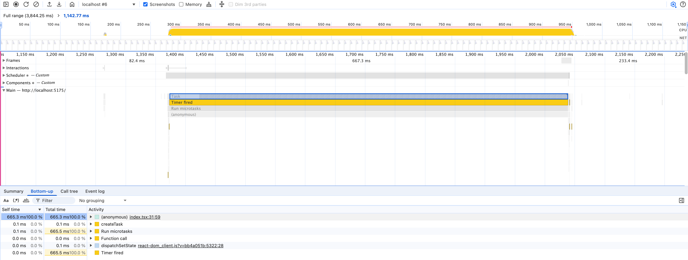
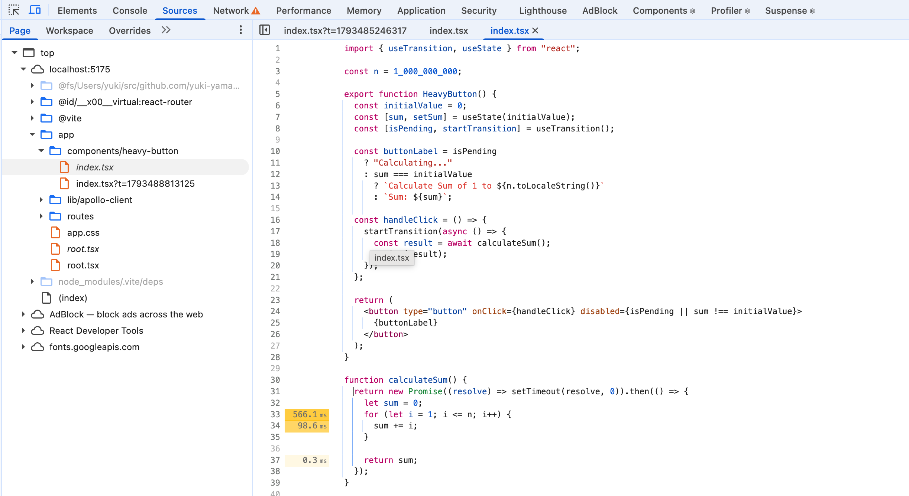
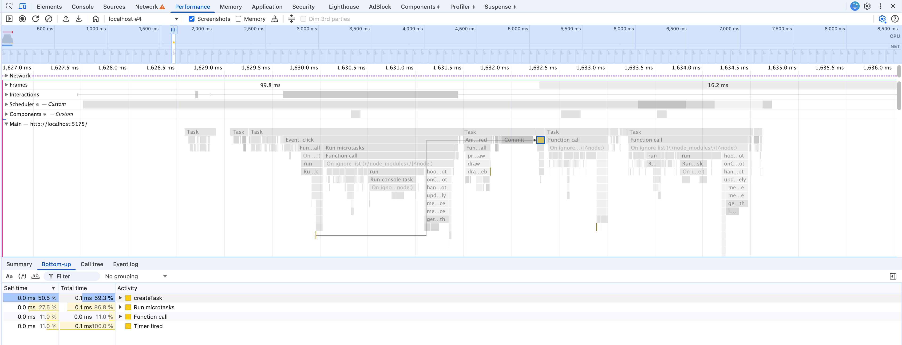

CPU-intensive tasks make UX so bad because they leave the page unresponsive for a while. To find and fix them, we can use the Performance and Sources tabs in Chrome DevTools.

The button component below blocks the main thread for more than 50 ms, which is called [a long task](https://web.dev/articles/optimize-long-tasks?utm_source=devtools&utm_campaign=stable) by Google.

```tsx
import { useTransition, useState } from "react";

const n = 1_000_000_000;

export function HeavyButton() {
  const initialValue = 0;
  const [sum, setSum] = useState(initialValue);
  const [isPending, startTransition] = useTransition();

  const buttonLabel = isPending
    ? "Calculating..."
    : sum === initialValue
      ? `Calculate Sum of 1 to ${n.toLocaleString()}`
      : `Sum: ${sum}`;

  const handleClick = () => {
    startTransition(async () => {
      const result = await calculateSum();
      setSum(result);
    });
  };

  return (
    <button
      type="button"
      onClick={handleClick}
      disabled={isPending || sum !== initialValue}
    >
      {buttonLabel}
    </button>
  );
}

function calculateSum() {
  return new Promise((resolve) => setTimeout(resolve, 0)).then(() => {
    let sum = 0;
    for (let i = 1; i <= n; i++) {
      sum += i;
    }

    return sum;
  });
}
```



The Performance tab clearly shows how long the task blocked the main thread. And if you click the `index.tsx` link, you'll see the code causing the performance problem. In this case, Chrome DevTools creates `index.tsx` from the module with a source map served by Vite.



After changing the algorithm in `calculateSum` function from O(n) to O(1), the long task disappeared and there was no performance problem.

```tsx
function calculateSum() {
  return new Promise((resolve) => setTimeout(resolve, 0)).then(() => {
    return (n * (n + 1)) / 2;
  });
}
```


