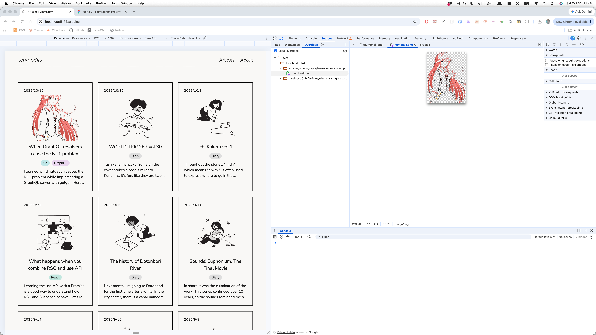

Chrome DevTools is very useful for debugging in frontend development. Recently, I learned how to override HTTP response content. Here is an example of temporarily replacing an image with a dummy one.

1. Open the "Sources > Overrides" tab in Chrome DevTools.
2. Click "Select folder for overrides".
3. Create a new folder then place a dummy image inside it.
4. Open the "Sources > Page" tab, right-click the image you want to replace, and select "Override content".
5. Reload the page.

## Photos

