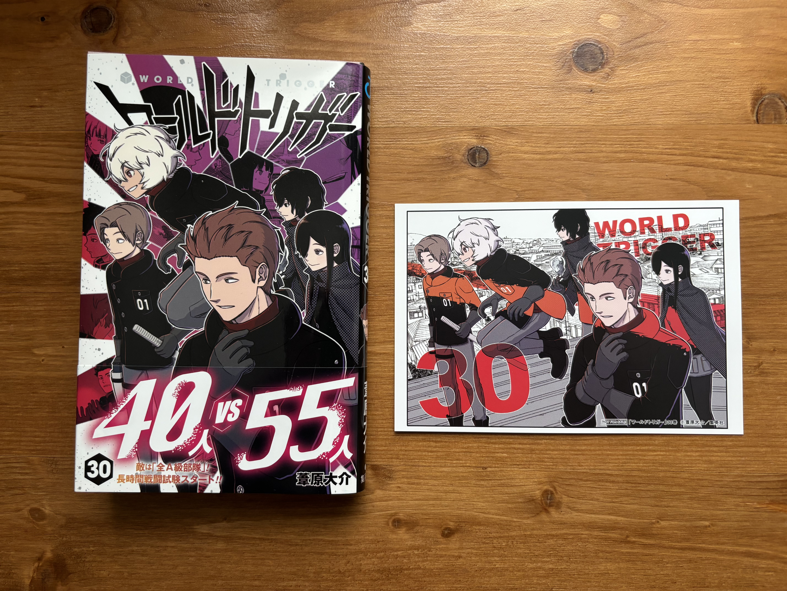
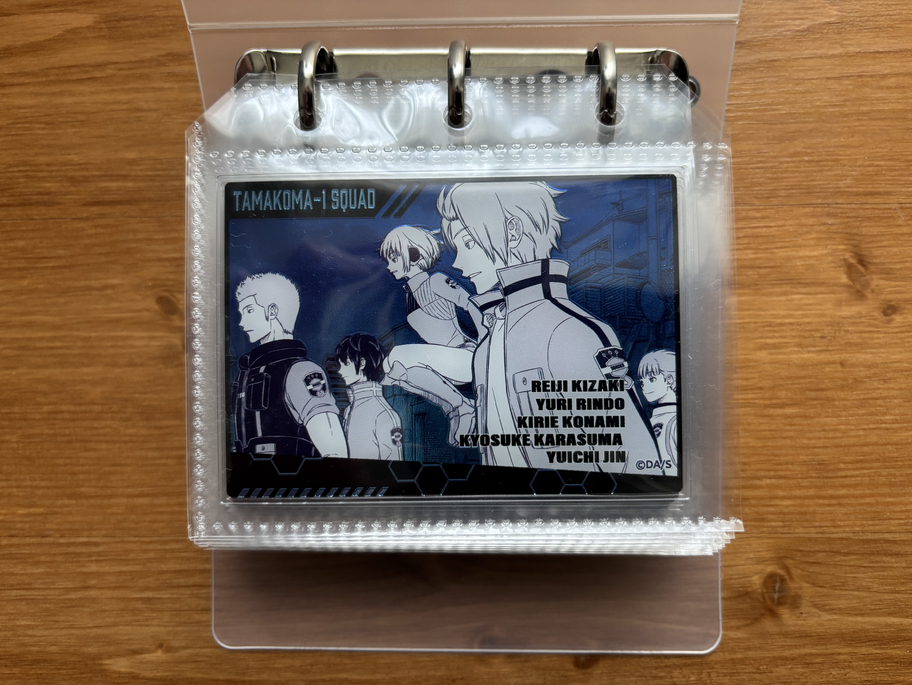

Tashikana manzoku. Yuma on the cover strikes a pose similar to Konami's. It's fun, like they are two of a kind. Here are a few things I'm curious about.

## Kusakabe squad

Ninomiya and Chika are being chased by the Kusakabe squad. My prediction is that Uno will stop them by sniping. If they face off, I wonder what Kusakabe will do. Will she join the battle as a gunner?

## Ilgars

Hyuse said that Hisato will bring down the Ilgars, but I don't think he has enough offensive skill. So, maybe Hyuse knows some weakness of the Ilgars, or he will give trion to Hisato like Chika did for Osamu before.

## The battle in the center

It seems like the B-rank squads are gradually being cornered, and I can't imagine that the members of Tamakoma-1 fail. If they keep losing ground, the use of trion soldiers could be the key to turning the tide.

## Photos

